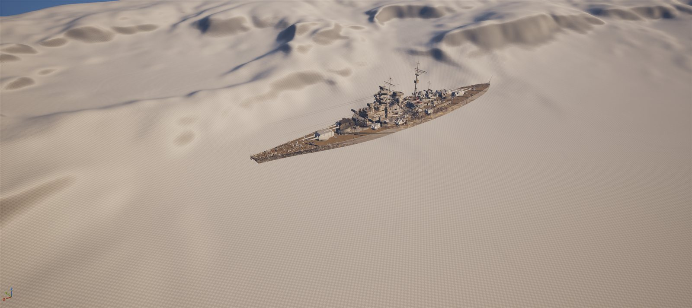
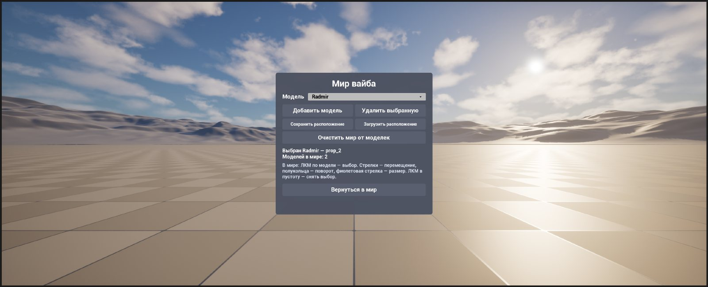
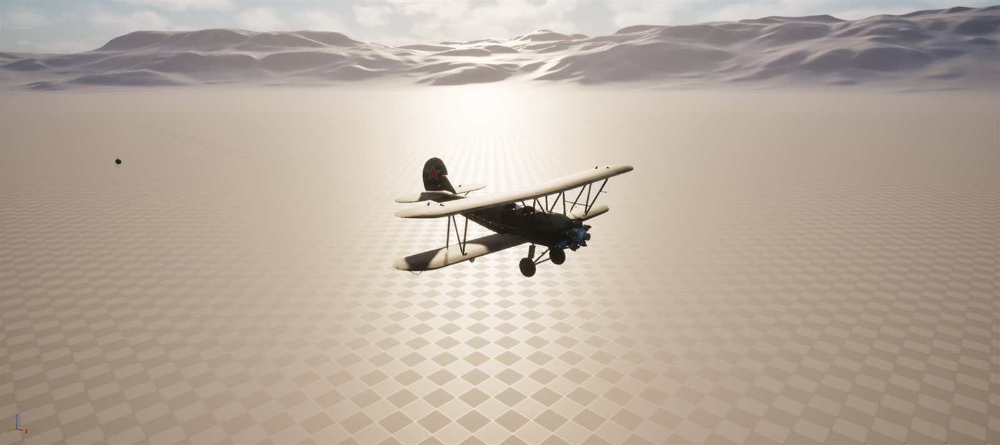
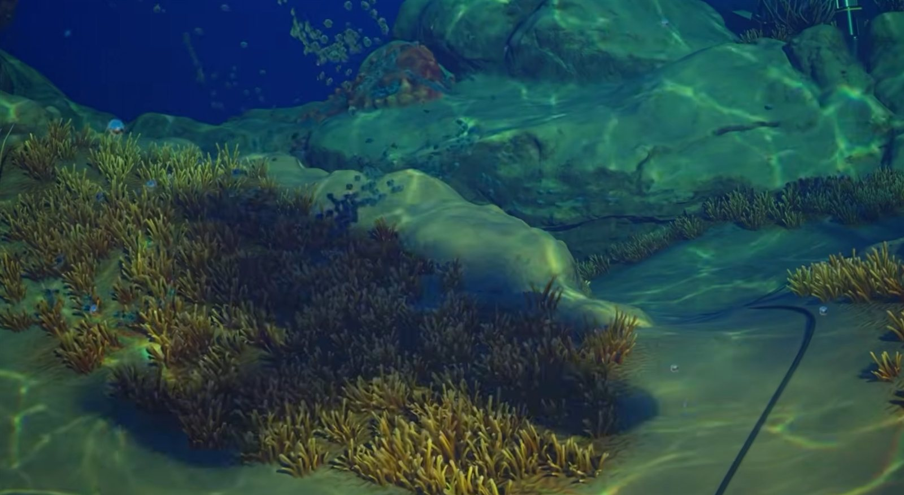
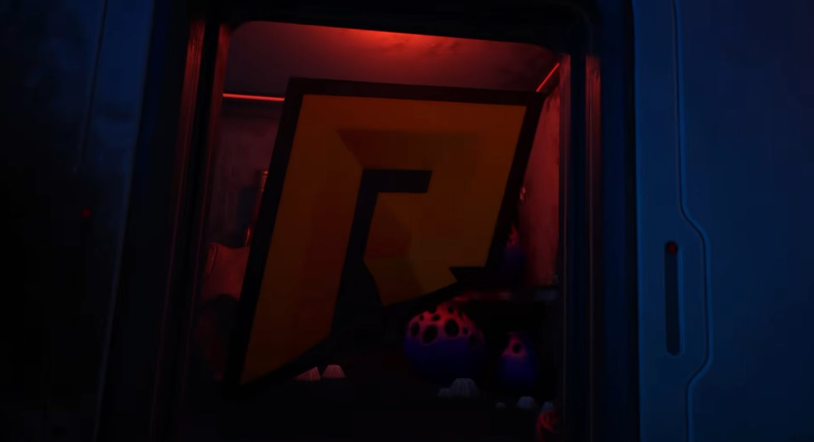

# WarThunderMOD — Subnautica 2

Spawn and arrange **3D models** inside **Subnautica 2**. Built for War Thunder and GTA 5 RP integrations.

[▶ Watch the demo — «Я Провёл 100 Дней в Subnautica VR»](https://youtu.be/5DPaWvmewY8) · [07:25](https://youtu.be/5DPaWvmewY8?t=445) · [16:05](https://youtu.be/5DPaWvmewY8?t=965)

> The mod was built for this video by **Имморталиус**. The video reached ~1M views in a few days.

> **Logic-only repository.** 3D models are **not** included — see [What's not included](#whats-not-included). This repo contains the Blueprint/Widget payload **and** the UE4SS Lua runtime.

---

## What's inside

The mod has two parts:

1. **Blueprint / Widget payload** — 11 `.uasset` files: menu, bindings, editor, scenarios, playback actor.
2. **UE4SS Lua runtime companion** — 14 Lua scripts: input bindings, scenario persistence, native spline playback, editor bridge, noclip, model catalog, placement layout.

## Screenshots

| War Thunder: Bismarck | Model menu — «Мир вайба» |
| --- | --- |
|  |  |

| War Thunder: Po-2 | |
| --- | --- |
|  | |

### From the video

| 07:25 | 16:05 |
| --- | --- |
| [](https://youtu.be/5DPaWvmewY8?t=445) | [](https://youtu.be/5DPaWvmewY8?t=965) |

## Features

- Spawn 3D models in the world and arrange them.
- Model menu **«Мир вайба»**: choose a model, add/remove, save/load layout, clear the world.
- Native spline playback for flight routes; Lua validates and builds the route once, Blueprint Tick drives the movement.
- Scenario documents with `binds.ini` / `scens/*.json` persistence outside `.pak` files.
- Desktop editor bridge, model inspector, link topology, noclip/free-flight.
- UE4SS runtime companion for input and persistence.

## Repository layout

```text
WarThunderMOD/
├── *.uasset                     # Blueprint/Widget payload
├── ue4ss/
│   └── Mods/
│       └── WarThunderMOD/
│           ├── README.md        # runtime companion notes
│           └── Scripts/         # 14 Lua modules
├── docs/screenshots/
├── README.md
├── NOTICE.md
└── LICENSE
```

## Install / use

### 1. Blueprint / Widget payload

Copy the root `.uasset` files into:

```text
Subnautica2-Project/Saved/Autosaves/Game/Mods/WarThunderMOD/
```

### 2. UE4SS Lua companion

Copy the `ue4ss/Mods/WarThunderMOD` folder into your UE4SS Mods directory:

```text
Subnautica2/Binaries/Win64/ue4ss/Mods/WarThunderMOD/
```

UE4SS must be installed for the Lua part. The companion owns user data at:

```text
Content/Paks/LogicMods/WarThunderMOD/binds.ini
Content/Paks/LogicMods/WarThunderMOD/scens/*.json
```

It discovers the installed LogicMods directory through `IterateGameDirectories()` and does not write user data into `.pak`/`.ucas`/`.utoc`.

### 3. 3D models

Add your own models to `ModelsFor3D/` and `Aircraft/` (not included). The repo intentionally contains only logic.

## Lua modules

| Module | Purpose |
| --- | --- |
| `main.lua` | Entrypoint: bindings, scenario picker, runtime wiring |
| `WTGameplayKeys.lua` | Saved-binding dispatcher |
| `WTScenarioDocument.lua` | JSON codec; unknown fields survive round-trip |
| `WTEditorModel.lua` | Editor document model |
| `WTEditorInspector.lua` | Property inspector profiles/curves |
| `WTEditorLinks.lua` | Point/link topology sync |
| `WTEditorUI.lua` | UMG capture bridge |
| `WTNativePlayback.lua` | Native spline playback |
| `WTPlayback.lua` | Legacy playback state machine |
| `WTRoute.lua` | Shared curve evaluator |
| `WTModelCatalog.lua` | Model IDs and actor classes |
| `WTNoclip.lua` | Noclip/free-flight |
| `WTVibeLayout.lua` | Placement document |
| `WTVibeRuntime.lua` | Placement runtime |

## Controls

| Key | Action |
| --- | --- |
| `Insert` | Open/close menu |
| `F5` | Toggle noclip / free flight |
| `F6` | Start selected scenario |
| `F7` | Open/close desktop editor |
| `F8` | Pause/resume playback |
| `F9` | Stop playback |

## What's not included

| Excluded | Size | Why |
| --- | ---: | --- |
| `ModelsFor3D/` (8 assets) | ~89 MB | Third-party 3D models |
| `Aircraft/` (2 assets) | ~1.5 MB | Third-party aircraft models |

Add your own models to these folders. The repository intentionally contains **only logic** so it stays light and does not redistribute third-party assets.

## Credits

> Created using the Unofficial Subnautica 2 modkit https://github.com/Subnautica2Modding/Subnautica2-Project/

## Disclaimer

Not affiliated with Unknown Worlds Entertainment, Focus Entertainment, Gaijin Entertainment, or Rockstar Games. Subnautica, War Thunder, GTA, and all related assets/trademarks belong to their respective owners. 3D models are not included.

## License

MIT for the repository's original logic and documentation. Third-party 3D models, trademarks, and game assets are not included and remain the property of their owners.
